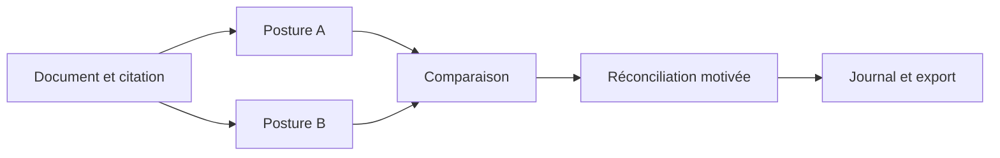

# Épistémè — Codage qualitatif et traçabilité des interprétations

Épistémè relie documents, citations, codes et mémos dans un espace de recherche qualitatif. Deux postures de lecture peuvent coexister sur un même extrait ; leurs divergences deviennent des objets de réconciliation explicites.

*A qualitative-research workspace for evidence-linked coding, contrasting interpretations, and inspectable audit records.*

**Stack :** React, TypeScript, Vite, Express, MongoDB et Docker.

## Chaîne de travail



## Ce que le projet démontre

- Une chaîne de travail : corpus → citation → codage → comparaison → réconciliation → export.
- Des sessions qui fixent le codeur, la posture et le corpus.
- Un journal dont les événements portent un rang, une empreinte précédente et une empreinte SHA-256.
- Des exports qui rendent le raisonnement et les limites inspectables.

## Parcours de lecture du code

| Question | Source |
| --- | --- |
| Comment les événements sont-ils chaînés et vérifiés ? | [Journal d'audit](server/src/lib/audit.ts) |
| Comment l'accès est-il contrôlé ? | [Authentification](server/src/lib/auth.ts) |
| Comment comparer les lectures ? | [Comparaison](frontend/src/pages/ComparePage.tsx) |
| Comment documenter une réconciliation ? | [Réconciliation](frontend/src/pages/ReconcilePage.tsx) |
| Quelle portée a réellement été livrée ? | [État du produit et limites](PRODUCT.md), [spécification](SPEC.md) |

Un bon scénario de démonstration utilise un court corpus fictif, applique deux lectures différentes au même extrait, motive une réconciliation, puis vérifie et exporte le journal.

## Démarrer en local

Prérequis : Docker et Node.js 22+.

```sh
npm install
npm --prefix server install
npm --prefix frontend install
npm --prefix server run migrate
npm run dev
```

Effectuer les migrations uniquement dans un environnement de développement isolé. La configuration locale et les conditions d'authentification figurent dans le guide détaillé.

## Limites à connaître

Le chaînage permet de détecter certaines modifications du journal ; il ne rend pas toute la base immuable. L'écriture métier et son événement d'audit ne sont pas transactionnels. Le verrou d'ajout sérialise un processus unique et doit être repensé pour plusieurs instances.

Le dépôt ne fournit pas actuellement de suite de tests automatisés dédiée. Les vérifications et limites décrites dans `PRODUCT.md` ne remplacent pas une exécution reproductible de tests.

[Detailed setup and operating guide](https://github.com/martinlepage26-bit/episteme/blob/b817e7fbb91d5ef59b2167168135767425e1e6e1/README.md)
